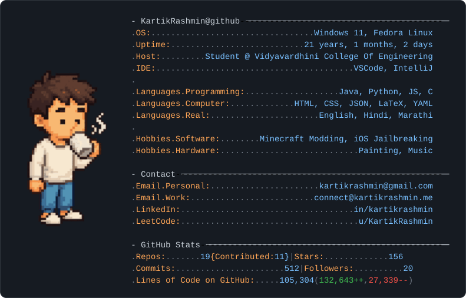
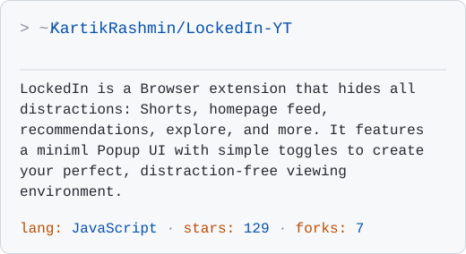
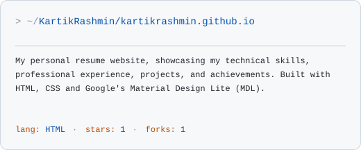
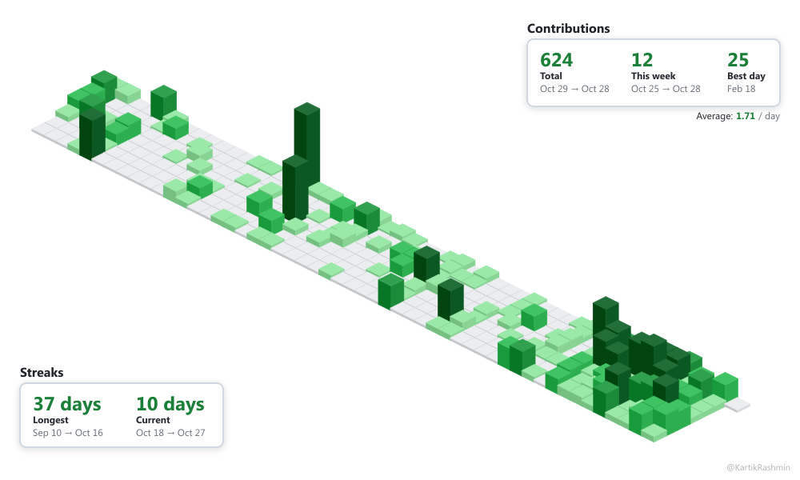
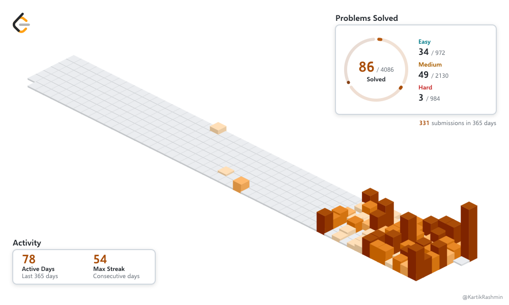

```bash
> fastfetch
```

<picture>
  <source media="(prefers-color-scheme: dark)" srcset="assets/fastfetch-transparent-dark.svg">
  <source media="(prefers-color-scheme: light)" srcset="assets/fastfetch-transparent-light.svg">
  
</picture>

<p align="center">
  <a href="mailto:connect@kartikrashmin.me"></a>
  <a href="https://kartikrashmin.me/"></a>
  <a href="https://www.linkedin.com/in/kartikrashmin/"></a>
  <a href="https://leetcode.com/u/KartikRashmin/"></a>
</p>

```bash
> ls ~/projects --featured
```

<!-- featured-projects:start -->
<div align="center">
<a href="https://github.com/KartikRashmin/LockedIn-YT"><picture><source media="(prefers-color-scheme: dark)" srcset="assets/featured/kartikrashmin-lockedin-yt-db710bab01-dark.svg"><source media="(prefers-color-scheme: light)" srcset="assets/featured/kartikrashmin-lockedin-yt-db710bab01-light.svg"></picture></a>
<a href="https://github.com/KartikRashmin/kartikrashmin.github.io"><picture><source media="(prefers-color-scheme: dark)" srcset="assets/featured/kartikrashmin-kartikrashmin-github-io-a5e1ee5430-dark.svg"><source media="(prefers-color-scheme: light)" srcset="assets/featured/kartikrashmin-kartikrashmin-github-io-a5e1ee5430-light.svg"></picture></a>
</div>
<!-- featured-projects:end -->

<br>

```bash
> git contributions --visualize
```

<picture>
  <source media="(prefers-color-scheme: dark)" srcset="assets/isometric-3d-dark.svg">
  <source media="(prefers-color-scheme: light)" srcset="assets/isometric-3d-light.svg">
  
</picture>


```bash
> leetcode submissions --visualize
```

<picture>
  <source
    media="(prefers-color-scheme: dark)"
    srcset="assets/leetcode-isometric-dark.svg">
  <source
    media="(prefers-color-scheme: light)"
    srcset="assets/leetcode-isometric-light.svg">
  
</picture>


```bash
> cat current-focus.txt
```

<!-- current-focus:start -->
```text
Building: Saefr Photos — a self-hosted photo and video management application.
Exploring: Backend engineering, system design, and open-source development.
```
<!-- current-focus:end -->
